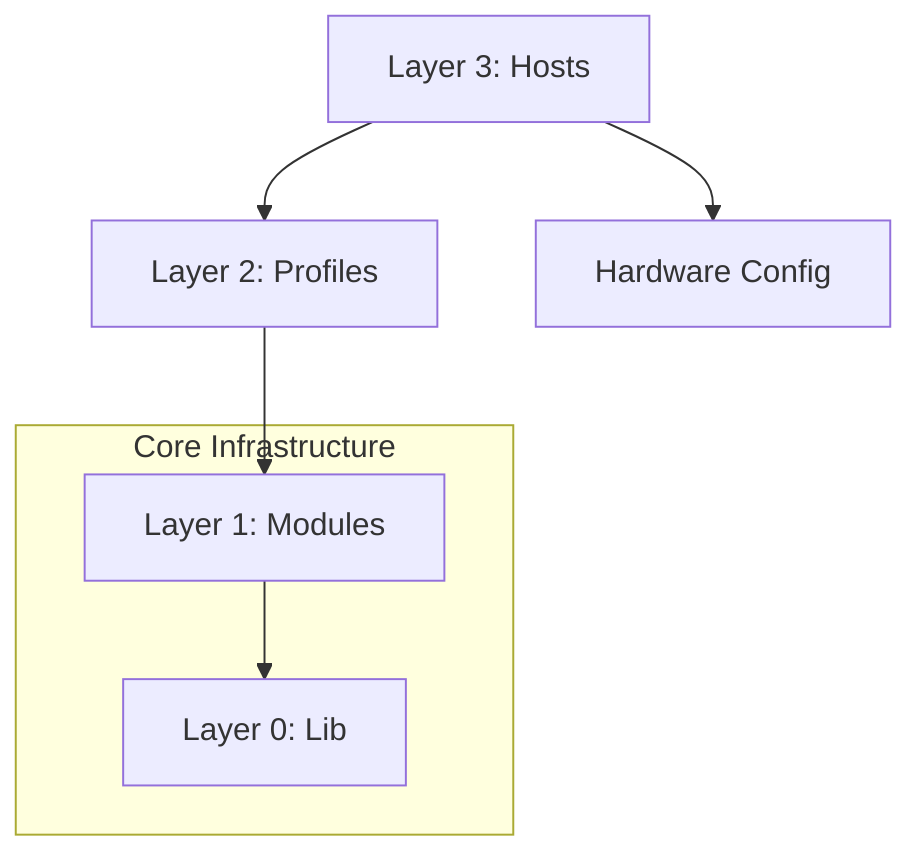

# Repository Architecture

This document defines the structural hierarchy and "Rules of Engagement" for the NixOS flake. Adhering to these rules prevents "topology bugs"—such as headless hosts inheriting desktop closures—and ensures the codebase remains scalable.

---

## 1. Structural Hierarchy

The configuration is organized into four distinct layers, with dependencies only flowing **downward**.

| Layer                 | Location                                           | Responsibility                                             | Side Effects?   |
| :-------------------- | :------------------------------------------------- | :--------------------------------------------------------- | :-------------- |
| **Layer 3: Hosts**    | `hosts/`                                           | Final assembly. Combines hardware, identity, and profiles. | **High**        |
| **Layer 2: Profiles** | `modules/nixos/profiles/`                          | Bundles modules into logical features (e.g., "Desktop").   | **High**        |
| **Layer 1: Modules**  | `modules/nixos/services/`, option-focused profiles | Defines custom options and internal logic (DSL).           | **Conditional** |
| **Layer 0: Lib**      | `lib/`                                             | Pure logic, registries, and schema definitions.            | **None**        |

---

## 2. Dependency Graph

---

## 3. Rules of Engagement

### Rule 1: The "Side-Effect" Gate

Files that have **unconditional side-effects** (e.g., adding packages to `environment.systemPackages` or enabling heavy services for every host) **MUST NOT** be imported globally in `modules/nixos/default.nix`.

- **Manual Opt-in:** Side-effectful NixOS profiles like `desktop.nix` and hardware modules like `hardware/nvidia-prime.nix` must be imported explicitly by the host. Home Manager workflow packs are enabled per host in its Home Manager module (`workflowPacks.*` in `home/users/user/main.nix`), not by global NixOS imports.
- **Home Manager entry modules by convention:** `flake/hosts.nix` imports
  `home/users/user/<role>.nix` for the registry's `homeManager.role`
  (`desktop.nix`, `server.nix`), plus `home/users/user/<host>.nix` when that
  file exists, such as `main.nix`. Use a host file for apps and aliases that
  should not leak into every desktop.
- **Global Infrastructure:** Globally imported files must either define reusable options or gate their effects behind explicit options/host metadata. The current global imports are `profiles/backup.nix`, `profiles/meta.nix`, `profiles/nix-trusted-users.nix`, `profiles/runtime-timezone.nix`, `profiles/observability/`, `services/systemd-failure-notify.nix`, and `services/hardened.nix`.
- **Conditional Global Profiles:** A profile such as `backup.nix` may be global only because it is inert unless `hostMeta.backup.class` is set.

### Rule 2: Closure Integrity

A host's Nix store closure should only contain what is explicitly requested.

- **Headless Safety:** Headless hosts (like `homeserver-gcp`) must never inherit GUI libraries or X11/Wayland dependencies.
- **Verification:** Use `nix build '.#checks.x86_64-linux.invariants-<host>'` to verify that unauthorized profiles haven't leaked into a host. Fleet-wide rules live in `lib/invariants.nix`; a rule that guards one host lives in `hosts/<name>/checks.nix`, beside the config it reads, and `flake/checks.nix` only wires them together.

### Rule 3: Single Source of Truth (Registry)

`lib/hosts.nix` is the **Single Source of Truth (SSoT)** for host metadata.

- **Multi-Arch Support:** Every host must define its target `system` (e.g., `x86_64-linux`), ensuring the flake evaluates correctly for heterogeneous fleets.
- **Lifecycle Status:** Every host in `lib/hosts.nix` must define `status`. `active` means a current runtime target, `inactive` means buildable but not operated, and `legacy-supported` means retained tooling with an explicit maintenance boundary.
- Network IDs, Tailscale tags, and roles must be defined in the registry, not hardcoded in modules.
- Hosts and infrastructure modules receive this data through the `hostMeta` and `hostRegistry` special args. Avoid duplicating registry-owned values in host modules unless the local value is truly hardware-specific.
- Generators may intentionally consume only a subset of the registry. For example, `lib/acl.nix` consumes `tailscale` metadata needed for explicit host:port policy (`tag`, `acceptFrom`, and `tailnetFQDN` when present) rather than inferring service exposure from host modules.

### Rule 4: Module vs. Profile

- **Modules** (`modules/nixos/services/`) define _how_ a service works and provide a DSL (e.g., `services.hardened`). They should be generic and reusable.
- **Profiles** (`modules/nixos/profiles/`) define _what_ is enabled. They set the policy for the fleet (e.g., "All desktop machines use Hyprland and PipeWire").

How each kind is switched on follows from that split. Modules, hardware
modules (`modules/nixos/hardware/`) and the public exports in
`flake/public-modules.nix` declare options and guard their config with
`lib.mkIf`, so importing one does nothing until a host sets its `enable`.
Preset profiles, in `modules/nixos/profiles/` and `home/profiles/`, are on
when imported: the import list is the switch, and they do not grow an
`enable` option just for uniformity. A profile that is imported globally
(Rule 1) or exported publicly is the exception and must be option-gated. Give
a preset an option only when a host needs to vary it, not to turn it off.

---

## 4. Layer Definitions

### Layer 0: Lib

Pure Nix functions. These must be "cold" (no imports of system modules). They define the schema for the rest of the flake.

### Layer 1: Modules

The building blocks. These introduce new attributes to the `services` or `programs` namespace. They should use `lib.mkIf` to ensure they do nothing unless their specific `.enable` option is set.

Current examples:

- `modules/nixos/services/hardened.nix` defines the `services.hardened` DSL.
- `modules/nixos/services/systemd-failure-notify.nix` defines failure notification options.
- `modules/nixos/profiles/observability/` defines the observability option surface and implementation, but remains inert unless `profiles.observability.enable = true`. It is exposed publicly as `nixosModules.observability-stack`; remote shipping is exposed as `nixosModules.observability-client`.

### Layer 2: Profiles

The "Features" of the system. A profile typically imports multiple modules and configures them to work together. Profiles are the primary unit of reuse between hosts.

### Layer 3: Hosts

The entry points. A host file should be a "thin" composition of:

1.  Hardware configuration (`hardware-configuration.nix`, or a shared module
    under `modules/nixos/hardware/` when VMs are identical, like `gce-vm.nix`).
2.  Disk layout (`disko.nix`).
3.  A list of Profile imports.
4.  Host-specific secrets and identity.

When a host's own configuration outgrows one file, `default.nix` stays the
entry point (imports, identity, profile settings, secrets) and each concern
gets a sibling file, as in `hosts/homeserver-gcp/` (`nginx.nix`,
`backups.nix`, …) and `hosts/main/` (`boot.nix`, `power.nix`,
`bluetooth.nix`, `usbguard.nix`, `agent-maintenance.nix`, …). A hardware
quirk that would apply to any machine with that device belongs in
`modules/nixos/hardware/` behind an option, not in the host.

The fleet's login account is `profiles.primaryUser` (default `user`, declared
in `modules/nixos/profiles/meta.nix`). NixOS modules and hosts read it rather
than spelling the name out, and Home Manager takes `home.username` from it
through `osConfig`. The `home/users/user/` directory name is only a path; test
fixtures that assert on the literal `user` stay literal.

Hand-maintained `hardware-configuration.nix` files must carry a short header
with their regeneration policy and a `Last reviewed: YYYY-MM-DD` note so it is
obvious when a checked-in hardware snapshot should be regenerated or manually
revalidated.

## 5. Local Package Boundary

Desktop applications that need custom runtime wrapping but are still repo-owned
should live under `packages/` and be exposed through flake `packages` and, when
useful, flake `apps`.

Current examples:

- `packages/quiet-shell/` owns the Quickshell desktop shell and its runtime
  wrapper; Home Manager consumes the packaged output.
- `packages/lazyactions/` builds a tool nixpkgs does not ship; the overlay in
  `flake/pkgs.nix` exposes it as `pkgs.lazyactions` to every host.
